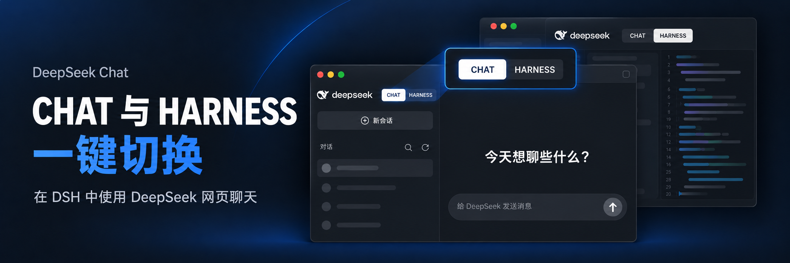
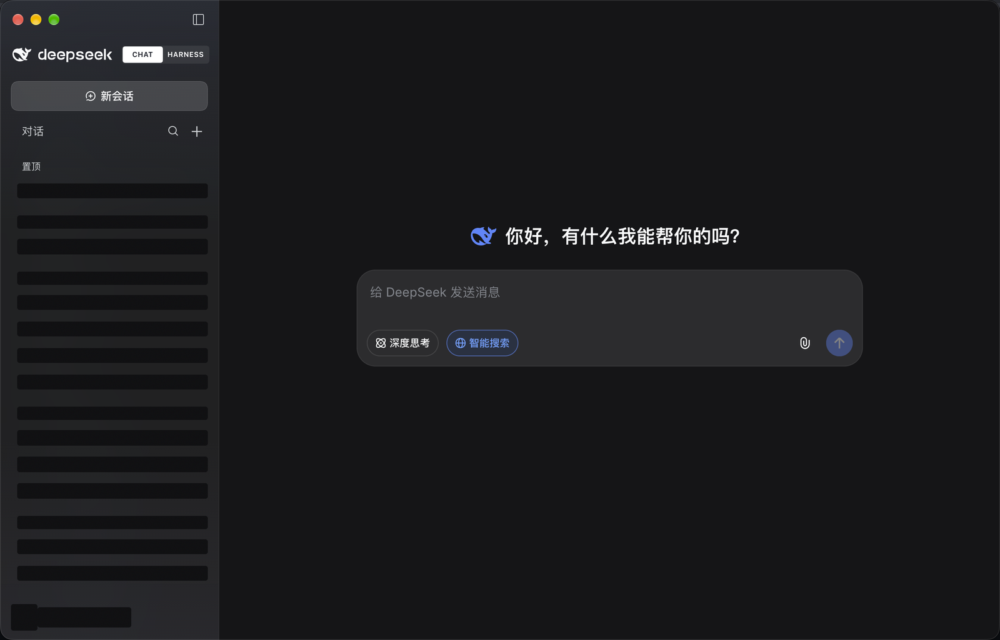
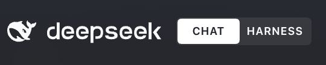
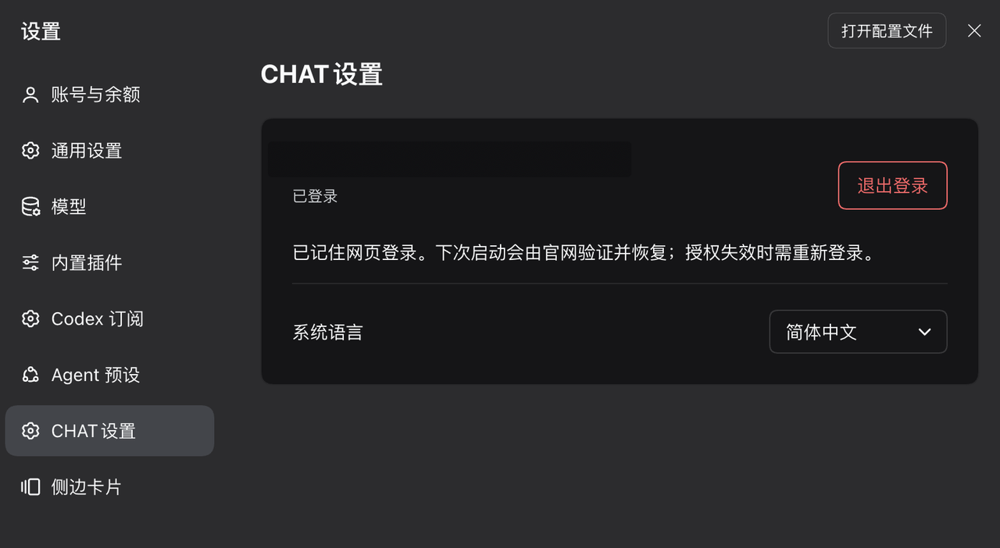

<h1 align="center">DeepSeek Chat</h1>

<p align="center"><strong>Switch between DeepSeek web chat and your Harness workspace in one click.</strong></p>

<p align="center"><a href="README.md">简体中文</a> · <strong>English</strong></p>

---

**CHAT** embeds the real [DeepSeek Chat website](https://chat.deepseek.com/), including its chat interface and account history. **HARNESS** returns you to the original DSH workspace.

Current version: **0.2.1** · Built for **DSH 0.2.0-rc.2 / 0.2.1-rc.1 Desktop** · Simplified Chinese is the default language; English and Follow system are also available.

## Preview

### DeepSeek web chat inside DSH



- Browse website conversation titles, pinned conversations and date groups in the existing DSH sidebar.
- Open each conversation’s More menu to rename, pin/unpin, share or delete it. Menus and the rename dialog use native DSH components, and the website saves the changes. Sharing and deletion retain the website’s confirmation flow.
- Continue an existing conversation or use the top New Chat button to start a website conversation.
- Refresh the current website page and conversation list using the refresh icon next to Chats. Use it to pick up conversations created in another browser without restarting DSH.
- Search the titles already loaded into the sidebar. The website provides the conversation content and composer.
- Conversation text, composer text and its placeholder follow the HARNESS content font size, which defaults to 14px. Changes to the DSH content font size also apply to CHAT.
- Click the conversation title at the top left to use the website’s own title editor.

### Switch back to HARNESS



The switch sits beside the DeepSeek brand at the top of the left sidebar. The white segment marks the active mode. Returning to HARNESS restores the panel that was open before CHAT; switching back to CHAT returns to the retained website page. When the sidebar is collapsed, reopen it using the original sidebar toggle.

### Language settings and remembered website sign-in



Open the native DSH **Settings → CHAT Settings** page to check website account status, sign out or change language.

- Simplified Chinese is the default. You can choose English or Follow system; confirmed choices are saved.
- CHAT uses a separate website sign-in. Signing out of the DSH account or CHAT does not disable the mode switch.
- Settings and the conversation page share the same website session. Account status and the conversation list update after sign-in, while the plugin saves the sign-in grant in the background.
- After signing in normally inside the plugin, **Website sign-in remembered** indicates that the grant has been saved. UI wording follows the selected language.
- Reopening the same DSH profile restores the grant for the website to validate. An expired grant requires a new sign-in.

## Installation

**To obtain the latest code already pushed to the repository, paste the repository URL into the DSH plugin installer.**

Installing by the npm name `dsh-deepseek-chat` can be affected by an existing lockfile, package metadata caching or pnpm’s minimum release age policy. A newly published version may not be selected immediately. For example, `minimumReleaseAge: 1440` means that a version must be at least **24 hours old** to satisfy that policy; it is not a fixed 24-hour cache. The actual behavior depends on the pnpm version and configuration used by DSH. See the [pnpm documentation](https://github.com/pnpm/pnpm.io/blob/main/versioned_docs/version-10.x/settings.md#minimumreleaseage).

A repository installation uses **source and compiled files already pushed to GitHub**. It does not include unpublished local changes. Existing installations still require a manual update and a full DSH restart.

### Install from the repository

Paste this URL into the DSH plugin installation field:

```text
https://github.com/xingxingbk-git/dsh-deepseek-chat
```

The repository includes source and prebuilt `lib` files. Installation loads the prebuilt distribution; no build scripts or changes to `allowBuilds` are required.

Alternatively, use the CLI:

```bash
dsh plugin --profile desktop add https://github.com/xingxingbk-git/dsh-deepseek-chat
```

The old npm name `dsh-chat` belongs to another project. Use `dsh-deepseek-chat` or the full repository URL.

### Install by package name

Enter this in the DSH plugin installation field:

```text
dsh-deepseek-chat
```

Or use:

```bash
dsh plugin --profile desktop add dsh-deepseek-chat
```

DSH installs the npm package. You do not need to run a separate `npx` command.

### Update an existing installation

An existing installation may retain its locked version. To request the current version explicitly, enter:

```text
dsh-deepseek-chat@0.2.1
```

An exact version identifies the target but may still be subject to the release age policy. The equivalent CLI command is:

```bash
dsh plugin --profile desktop add dsh-deepseek-chat@0.2.1
```

**Fully quit and reopen DSH**, then check that the plugin manager shows **0.2.1**. In CHAT, the Chats header should have a refresh icon, and the signed-out page should have a blue sign-in button.

Replace `desktop` when using another profile. Update through the official DSH plugin manager or CLI so the dependency record and lockfile are updated together. Directly replacing files in the installation directory does not guarantee that the next launch will load the new version.

### Install a local package

Install a built `.tgz` with the official DSH plugin manager, or run:

```bash
dsh plugin --profile desktop add /absolute/path/dsh-deepseek-chat-0.2.1.tgz
```

Replace the path with your actual package file and `desktop` with your profile if necessary. **Fully quit and reopen DSH after installation or an update.**

If you previously installed this repository’s `dsh-chat` plugin, disable and remove it before installing `dsh-deepseek-chat` so two versions do not control the interface at once. The newer plugin can attempt to migrate its own earlier saved website grant; if the old record cannot be located, sign in normally again.

See the [official DSH plugin installation documentation](https://deepseek-harness.github.io/deepseek-harness/en/develop/basic/publish).

## Getting started

1. Select **CHAT**. If signed out, choose **Sign in to DeepSeek**. The same entry is available in **Settings → CHAT Settings**.
2. Complete sign-in on the real website in the CHAT main page. CHAT Settings displays account status and language. Its sign-in button closes Settings and opens CHAT; account details and conversations synchronize afterward without a manual refresh.
3. Check the remembered sign-in status in **Settings → CHAT Settings**, then choose your language. Signing out clears the plugin’s saved grant and signs out of the website; the mode switch remains available.

Website sign-in happens inside the plugin. Automatic authorization from an external browser would require a Chat authorization exchange interface from the website, which has not been confirmed. Signing in elsewhere does not automatically sign in this plugin.

If the website cannot load, use the retry action in its status panel. If the sign-in persistence service cannot connect, the interface shows an error and a retry action. The plugin automatically collapses the website’s fixed environment warning; other notices, verification challenges and authentication errors remain under website control.

Refreshing the list reloads the current website page and retains the conversation URL. If an unsent draft or an active generation is detected, complete that activity first; the plugin does not back up drafts. Wait for the refresh to finish. If loading fails or times out, use the website retry action on the right.

## Limitations

- **Compatibility:** currently adapted for DSH 0.2.0-rc.2 / 0.2.1-rc.1 Desktop. Other versions and platforms require further validation. CHAT is not supported in DSH Web.
- **Website navigation:** the sidebar mirrors navigation already loaded by the website. It depends on the website’s page structure and is not an official history API. When the structure cannot be recognized, the native website navigation is restored while detection retries; the sidebar and CHAT Settings synchronize after recovery.
- **New Chat shortcuts:** the top New Chat button supports mouse and Enter activation. Original Harness shortcuts and menu commands still perform Harness actions and may create a Harness session and leave CHAT.
- **Remembered sign-in:** the website session is separate from Safari/Chrome and from the DSH platform account. Expiry, revocation or website changes may require signing in again. Long-term behavior, full uninstall and broader platform coverage still require further validation.
- **Page lifetime:** manual mode switching retains the website page. Disabling or uninstalling the plugin, or fully quitting DSH, destroys the container. The plugin does not back up unsent drafts or replace the website’s generation controls.
- **Browser capabilities:** downloads, device permissions and some popups are restricted by DSH Browser policy. Sending, uploads, cross-browser history consistency and long-term operation require broader real-world validation.

## Privacy and data

DeepSeek’s website handles chats and account history. To adapt the interface, the plugin reads visible navigation titles, groups, links, account display names and language settings. Navigation metadata remains in memory during the current authorized lifetime. Language preferences are saved through the official DSH configuration service.

Remembered website sign-in processes only the minimum grant data from the plugin’s own `chat.deepseek.com` page and stores it through the official DSH credentials service. The plugin derives a separate record identifier from the profile path supplied by the DSH launcher, keeping profiles separate and associating the grant with its website account. Signing out clears the previous grant and fences off late save operations. Without trusted profile context, normal website sign-in still works, but it cannot be remembered. This depends on the website’s current implementation, is not a stable official OAuth interface and does not promise permanent sign-in.

The plugin does not store passwords, cookies or message bodies, read tokens belonging to DSH or other plugins, access other browsers’ sign-in data, call private authentication APIs, modify the DSH application package or disable web security. See the [architecture notes](docs/architecture.md) and [website session notes](docs/browser-session-capability.md) for the data flow and authorization boundaries; these technical notes are in Chinese.

## Development and packaging

Requirements: Node.js 22.19+ on the 22.x line, or Node.js 24+, and pnpm 10.33.2. Runtime dependencies target Cordis 4.0.4 and React 18.3.1.

```bash
git clone https://github.com/xingxingbk-git/dsh-deepseek-chat.git
cd dsh-deepseek-chat
pnpm install --frozen-lockfile
pnpm package:plugin
```

This produces `artifacts/dsh-deepseek-chat-0.2.1.tgz`, containing Host and Client code, declarations, the icon, locale metadata and the bundle patch. The plugin-manager icon is `assets/icon.svg`; replace it and rebuild to change the icon. The SVG must be self-contained and no larger than 256 KiB.

After source changes, run `pnpm release:prepare` and commit the source together with the complete `lib/` directory. `pnpm check:distribution` checks the compiled files against the source, version and installation entry. Stale or missing output fails the check. People installing the plugin do not need these development commands.

To uninstall:

```bash
dsh plugin --profile desktop remove dsh-deepseek-chat
```

## Known issue: copying share links

CHAT can create share links, but **Create and copy** or **Copy** may report a copy failure. DSH Desktop’s embedded browser denies webpage clipboard permission requests and currently exposes no setting to enable them. Select the complete link and press `⌘C` on macOS or `Ctrl+C` on Windows to copy it manually.
